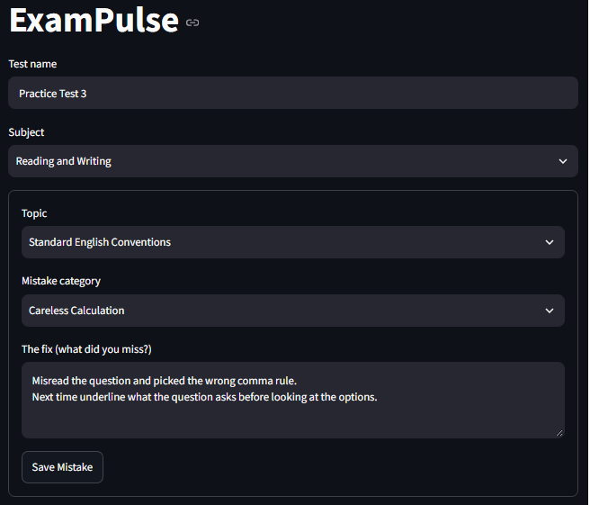
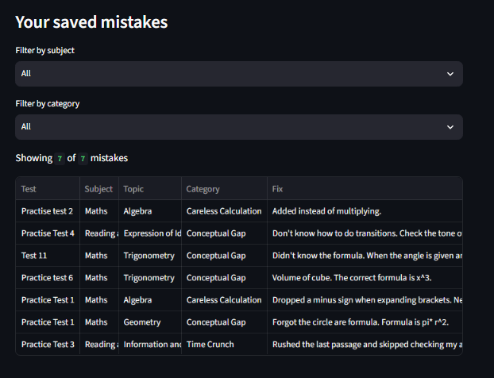
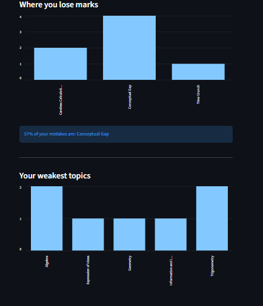
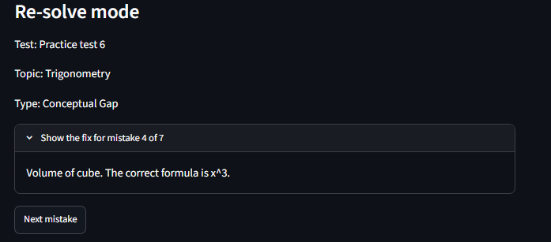

# ExamPulse

A Python web app that turns exam mistakes into data, so you can see where you actually lose marks.

## The problem
After a practice test, most students re-study everything. But most lost marks come from a few repeated problems: a concept they never understood, careless slips, or running out of time. ExamPulse logs each mistake with its topic and reason, then shows which ones matter most.

## Features
- **Mistake log:** record the test, subject, topic, mistake category (Conceptual Gap, Careless Calculation, Time Crunch) and a note on the fix
- **Smart dropdowns:** the topic list changes with the subject
- **Filters:** view mistakes by subject and category
- **Analytics:** a chart of mistakes by category, a chart of weakest topics, and a summary sentence such as "50% of your mistakes are: Conceptual Gap"
- **Re-solve mode:** go through old mistakes one at a time, with the fix hidden until you click

## Built with
Python, Streamlit and Pandas

## How to run it
1. Install Python 3.9 or newer (on Windows, tick "Add Python to PATH")
2. Download this repository (Code > Download ZIP) and unzip it
3. Open a terminal in the folder and run `pip install -r requirements.txt`
4. Run `streamlit run mypulse.py`

Your mistakes are saved locally in `mistakes.csv` and are never uploaded.

## Screenshots

## Future ideas
- Save a date with each mistake and chart progress over time
- Separate profiles for each user
- An online version with a database
